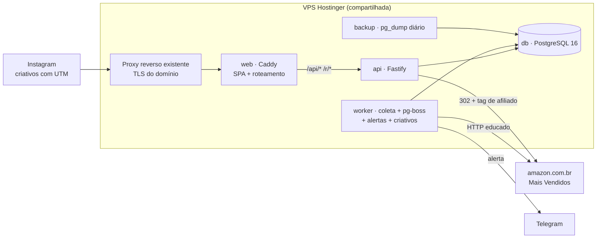

# Arquitetura: visão geral

## 1. Diagrama de containers

## 2. Containers

| Serviço | Imagem | Função | Memória | Redes |
|---|---|---|---|---|
| `db` | postgres:16-alpine | dados e fila do pg-boss | 512 MB | interna |
| `api` | `amazonafiliados-api` | API REST, `/r/:asin`, sessão do admin, OpenAPI | 256 MB | interna |
| `worker` | `amazonafiliados-worker` | agenda (pg-boss), coleta, limpeza, alertas, criativos | 384 MB | interna (com saída à internet) |
| `web` | `amazonafiliados-web` | Caddy sem TLS: serve a SPA e repassa `/api` e `/r` | 64 MB | interna + `${PROXY_NETWORK}` |
| `backup` | postgres:16-alpine | `pg_dump` diário com retenção | 64 MB | interna |

Só o `web` entra na rede do proxy existente, e nenhum container publica porta. Os detalhes estão em `docs/infra/vps-hostinger.md`.

## 3. Fluxo da coleta (RF-04, RF-05)

1. O pg-boss dispara `scrape:all` conforme `SCRAPE_CRON`.
2. O worker verifica `scrape_paused` e `blocked_until`, cria um `scrape_run` e percorre as categorias ativas **uma por vez**.
3. Para cada categoria:
   - baixa a página (fetcher educado);
   - faz o parse e valida os itens com zod;
   - grava tudo numa transação: upsert de `products`, troca de `category_products`, snapshot em `rankings` e linha em `price_history` quando o preço mudou.
4. Se houver bloqueio, o worker aborta o run, grava `blocked_until`, envia alerta e **não apaga nada**.

As regras completas estão em `docs/worker/coleta.md`.

## 4. Fluxo do clique (RF-03, RF-08)

1. O visitante chega com `?utm_source=instagram&utm_campaign=...`. A SPA guarda os `utm_*` no `sessionStorage`.
2. O card aponta para `/r/{ASIN}?utm_...&cat={slug}`.
3. A API valida o ASIN, grava o clique (sem IP) e responde `302` para `https://www.amazon.com.br/dp/{ASIN}?tag={AMAZON_AFFILIATE_TAG}`.

## 5. Fluxo do admin (RF-07)

1. `/admin/login` faz `POST /api/admin/login` e recebe o cookie `sid` (`httpOnly`).
2. As páginas do admin chamam `/api/admin/*`.
3. "Forçar coleta" enfileira `scrape:all` ou `scrape:category` no pg-boss.

## 6. Ambientes

| Ambiente | Como sobe | Banco |
|---|---|---|
| dev (máquina local) | `infra/compose.dev.yml` só com o Postgres; `pnpm dev` roda api, worker e web com recarga automática | volume local |
| teste | Vitest: unitários sem banco; integração com `DATABASE_URL_TEST` (o mesmo Postgres de dev, banco `amazonafiliados_test`) | recriado por suíte |
| produção (VPS) | `infra/compose.yml` + `infra/compose.proxy.yml`, com imagens do GHCR | volume `pgdata` + backup |

## 7. Variáveis de ambiente (fonte do `.env.example`)

| Variável | Exemplo | Usada por |
|---|---|---|
| `COMPOSE_PROJECT_NAME` | `amazonafiliados` | compose |
| `POSTGRES_PASSWORD` | (segredo) | db, api, worker, backup |
| `DATABASE_URL` | `postgres://app:${POSTGRES_PASSWORD}@db:5432/amazonafiliados` | api, worker |
| `PUBLIC_BASE_URL` | `https://maisvendidos.exemplo.com.br` | api, worker (links dos criativos) |
| `AMAZON_AFFILIATE_TAG` | `seutag-20` | api |
| `SHOW_PRICE_DEFAULT` | `true` | api (padrão de `show_price`) |
| `PRICE_MAX_AGE_HOURS` | `24` | api |
| `SCRAPE_ENABLED` | `true` | worker |
| `SCRAPE_CRON` | `0 */6 * * *` | worker |
| `SCRAPE_DELAY_MIN_S` / `SCRAPE_DELAY_MAX_S` | `20` / `60` | worker |
| `SCRAPE_TOP_N` | `30` | worker |
| `SCRAPE_USER_AGENT` | navegador comum, fixo | worker |
| `ADMIN_EMAIL` | `dono@exemplo.com.br` | api |
| `ADMIN_PASSWORD_HASH` | hash argon2 (gerado por `pnpm --filter api hash-senha`) | api |
| `SESSION_SECRET` | 32+ bytes aleatórios | api |
| `TELEGRAM_BOT_TOKEN` / `TELEGRAM_CHAT_ID` | (opcionais) | worker |
| `PROXY_NETWORK` | nome da rede do proxy existente | compose (prod) |
| `WEB_CONTAINER_NAME` | `amazonafiliados-web` | compose (prod) |
| `WEB_PORT` | `8081` (só com `compose.hostport.yml`) | compose (prod) |
| `IMAGE_TAG` | SHA do commit | compose (prod) |
| `BACKUP_RETENTION_DAILY` / `BACKUP_RETENTION_WEEKLY` | `7` / `4` | backup |

## 8. Decisões

ADR-001 monorepo · ADR-002 API · ADR-003 vitrine SPA · ADR-004 coleta · ADR-005 preço · ADR-006 deploy · ADR-007 criativos · ADR-008 processo. Todos ficam em `adr/`.
